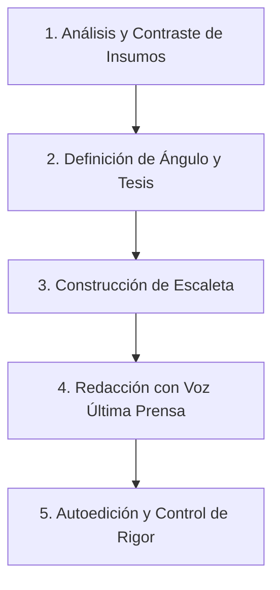

# Redacción de Reportajes – Estilo Última Prensa

Este skill guía la investigación, estructuración, redacción y autoedición de reportajes periodísticos con el tono incisivo, riguroso, humano y analítico característico del periodismo de investigación moderno y digital.

---

## Principios Fundamentales del Estilo Última Prensa

1. **Rigor y Verificación Absoluta:** Ninguna afirmación de peso se sostiene sin sustento (documento oficial, base de datos, testimonio con nombre o fuente confidencial contrastada).
2. **Narrativa sin Ficción:** Prosa envolvente, visual y humana que capta el interés sin caer en la adjetivación vacía o el sensacionalismo. Los hechos y los datos son los protagonistas.
3. **Equilibrio y Derecho a Réplica:** Toda acusación, denuncia o señalamiento institucional debe incluir la contraparte o la constancia explícita de que se solicitó versión y el estado de la respuesta.
4. **Claridad Estructural y Contexto:** Cada cifra se contextualiza (porcentajes, comparativas históricas, costo social/humano).

---

## Flujo de Trabajo para Redactar un Reportaje

Sigue estos 5 pasos estructurados al recibir una solicitud o insumos (notas, documentos, testimonios, tema):

### Paso 1: Análisis y Contraste de Insumos
- Identifica los **hechos comprobables**, los **testimonios de afectados/protagonistas**, las **cifras clave** y los **vacíos de información**.
- Clasifica las fuentes en: *Oficiales*, *Afectados/Ciudadanía*, *Expertos/Analistas independientes* y *Documentación pública o pericial*.

### Paso 2: Definición de Ángulo y Tesis Central
- Formula la tesis periodística en una sola oración contundente: *¿Qué revela este reportaje que antes no se sabía o no se entendía en su dimensión real?*
- Elige el tipo de reportaje adecuado según las [Plantillas de Reportaje](./references/plantillas.md):
  - **Investigación / Denuncia:** Revelación de irregularidades, fiscalización de poder o fondos públicos.
  - **Explicativo / Análisis de Datos:** Desglose de fenómenos complejos (economía, crisis social, tecnología).
  - **Crónica Humana / Testimonial:** El impacto de un suceso a través de historias de vida y comunidad.
  - **Perfil en Profundidad:** Radiografía crítica de un personaje público, líder o institución.

### Paso 3: Construcción de la Escaleta
Antes de redactar, define los bloques estructurales bajo el **formato canónico de Última Prensa**:
- **Titular:** Contundente, con verbo de acción y síntesis del hallazgo (sin *Title Case* anglosajón).
- **Bajada del Reportaje:** En bloque de cita destacada (`> *...*`), **en cursiva y estrictamente sin negrita**.
- **Firma de Autoría:** Separada por pleca divisoria (`---`).
- **Lead / Párrafo de Entrada:** Inicia directamente en la narración, **sin subtítulo ni encabezado de introducción** (prohibido `### Introducción`).
- **Tuerca de la Historia (Nut Graf):** Contexto inmediato de por qué este hecho interpela a la sociedad hoy.
- **Bloques Temáticos con Ladillos:** Desarrollo argumental con evidencia documental, voces institucionales y tablas (encabezados `###` con mayúscula inicial únicamente).
- **Remate:** Cierre categórico sin clichés.
- **Nota Metodológica Obligatoria:** Dispuesta en bloque de llamado de atención / cita destacada (`> *...*`), **en cursiva y sin subtítulo** (prohibido titularla `### Nota metodológica`). Enlaza: Open Legal Chile, Última Prensa Journalism Kit, Gemini 3.8 Flash, Graphify y Google Antigravity IDE.
- **Fuentes Documentales:** Sección final estandarizada en formato APA 7ma Edición adaptada a referencias legales y administrativas.

### Paso 4: Redacción con Voz Editorial
- Consulta el [Manual de Estilo Última Prensa](./references/manual_estilo.md) para lineamientos de tono, atribución de citas y reglas sintácticas.
- Utiliza **destacados (*pull quotes*)** y **cajas de datos/claves** para dinamizar la lectura digital.
- Revisa el [Reportaje de Ejemplo](./examples/ejemplo_reportaje.md) como referencia de ritmo y acabado final.

### Paso 5: Escrutinio de la Mesa de Edición y Módulos Obligatorios de Control
Aplica la doctrina del [Manual del Editor de Investigación (KAS)](./references/manual_editor_investigacion_kas.md) (*Investigative Journalism Manual*, Capítulo 8) y corre los módulos obligatorios:
- [ ] **Módulo de Mayúsculas:** Todos los cargos públicos e institucionales en minúscula (*presidente*, *ministro*, *biministro*, *subsecretario*, *directora nacional*, *contralora general*, *fiscal jefe*, *alcaldesa*, *gobernador*, etc.). Erradicación total del *Title Case* en títulos, subtítulos y viñetas.
- [ ] **Regla de adición acumulativa:** Cero resumen; siempre sumar y complementar datos técnicos, montos y expedientes al dossier base.
- [ ] **El corazón del reportaje:** ¿Se formula con nitidez la tesis en los primeros párrafos?
- [ ] **El revólver humeante (*smoking gun*):** ¿Existe respaldo documental o contable irrebatible para la imputación principal?
- [ ] **Párrafos como mini-historias:** ¿Cada párrafo articula evidencia, contexto, causa-efecto y consecuencias?
- [ ] **Prohibición de redundancia territorial:** Cero uso de «Chile», «chileno», «chilena» en la prosa narrativa.
- [ ] **Variación correferencial y economía léxica:** ¿Se eliminaron repeticiones de nombres propios y cargos mediante sinónimos institucionales? (Auditar con `python kit-journalism/scripts/detector_redundancia_lexica.py`).
- [ ] **Auditoría integral pre-vuelo:** Ejecutar `python kit-journalism/scripts/verificar_reportaje.py <reportaje.md>` para validar automáticamente las 10 reglas editoriales canónicas, RAE y KAS antes de exportar a Substack.
- [ ] **Validación ortotipográfica RAE:** Cumplimiento de `normas_rae_puntuacion.md` y chequeo con `python kit-journalism/scripts/rae_client.py`.
- [ ] **La prueba del oído:** ¿El texto fluye al leerse en voz alta, manteniendo un ritmo ágil sin atascar al lector?
- [ ] **Regla del 10 % y remate:** ¿La introducción no supera el 10 % del texto y el cierre concluye de forma categórica, sin clichés evasivos como *«solo el tiempo lo dirá»*?

---

## Archivos de Referencia Rápida
- [Manual del Editor de Periodismo de Investigación (KAS / Capítulo 8)](./references/manual_editor_investigacion_kas.md)
- [Manual de Estilo y Normas Periodísticas](./references/manual_estilo.md)
- [Manual de Citación Documental Forense (APA 7 / GIJN)](./references/manual_citas_periodismo_investigacion.md)
- [Plantillas Estructurales de Reportajes](./references/plantillas.md)
- [Reportaje Modelo de Referencia](./examples/ejemplo_reportaje.md)

